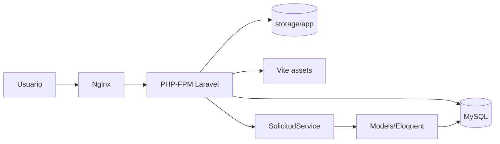
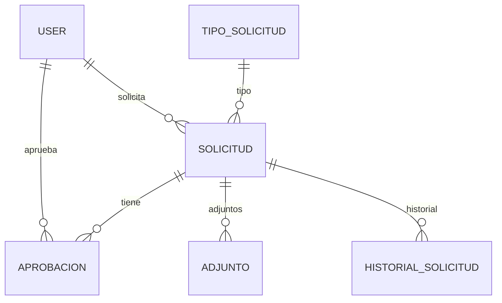
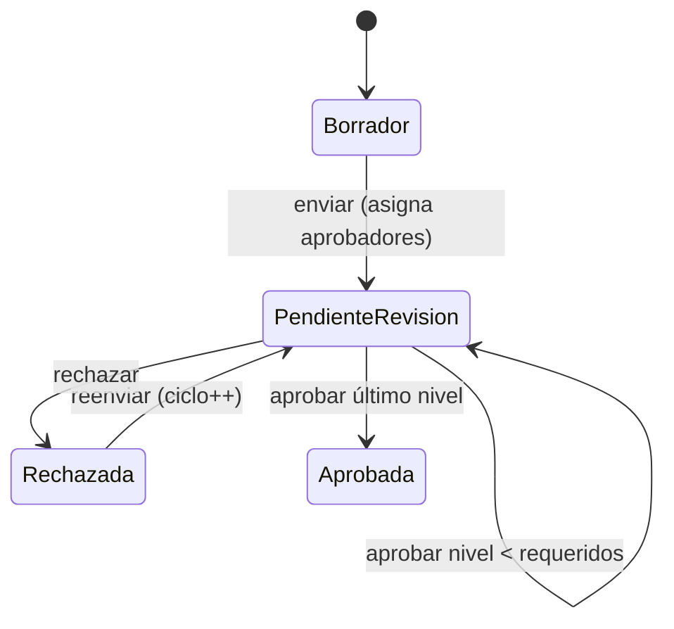
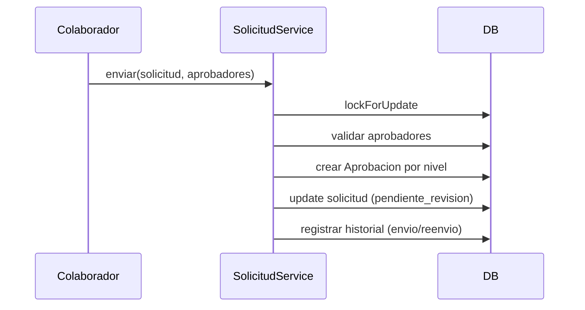

# Documentación del Proyecto: Sistema de Solicitudes y Aprobación Multinivel

## 1. Resumen ejecutivo

Aplicación web Laravel 13 (PHP 8.3) que gestiona un flujo de **aprobación multinivel de solicitudes** con tres roles (`colaborador`, `aprobador`, `administrador`). Incluye adjuntos, historial inmutable, comentarios, filtros y un segundo nivel de aprobación según monto. Se ejecuta en contenedores Docker (app PHP-FPM, nginx, MySQL 8) y usa Vite/Tailwind para el frontend.

## 2. Estructura del repositorio

```
solicitudes/
├── docker/                  # Dockerfile PHP-FPM, entrypoint, nginx
├── docker-compose.yml       # app, web, db, node (profile tools), adminer
├── src/                     # Aplicación Laravel
│   ├── app/
│   │   ├── Enums/           # Rol, EstadoSolicitud, EstadoAprobacion, AccionHistorial, Prioridad
│   │   ├── Http/Controllers # Solicitud, Resolucion, Comentario, Adjunto, Auth, Profile
│   │   ├── Http/Requests    # GuardarSolicitudRequest, EnviarSolicitudRequest
│   │   ├── Models/          # Solicitud, Aprobacion, Adjunto, HistorialSolicitud, TipoSolicitud, User
│   │   ├── Policies/        # SolicitudPolicy
│   │   └── Services/        # SolicitudService (lógica de negocio)
│   ├── config/              # solicitudes.php (umbral 2da aprobación)
│   ├── database/            # migrations, seeders, factories
│   ├── resources/views/     # Blade (Breeze + solicitudes)
│   ├── routes/              # web.php, auth.php
│   └── tests/               # Feature (Example, Profile) + Unit
└── AGENTS.md
```

## 3. Arquitectura

- **Patrón**: MVC Laravel con capa de servicio (`SolicitudService`) para transiciones de estado.
- **Persistencia**: MySQL 8 en producción/dev; SQLite `:memory:` en tests.
- **Frontend**: Blade + Tailwind + Alpine + Vite.
- **Autorización**: `SolicitudPolicy` basada en rol y propiedad.
- **Estado**: enums string para solicitudes y aprobaciones.

### Diagrama de componentes



## 4. Modelo de datos

### Entidades principales
- **User**: rol (`colaborador`/`aprobador`/`administrador`).
- **TipoSolicitud**: catálogo con `requiere_monto`, `esquema_campos`.
- **Solicitud**: folio generado al crear, estado, prioridad, monto, datos JSON, niveles.
- **Aprobacion**: por solicitud/ciclo/nivel, aprobador, estado, comentario.
- **Adjunto**: archivo en disco local.
- **HistorialSolicitud**: inmutable (no update/delete).

### Diagrama ER



## 5. Flujo de negocio

### Estados de solicitud
`borrador → pendiente_revision → aprobada | rechazada` (rechazada puede reenviarse, incrementando `ciclo`).

### Diagrama de estados



### Niveles de aprobación
`SolicitudService::nivelesRequeridos()` retorna 2 si `monto > umbral` (default 50000, env `SOLICITUDES_UMBRAL_SEGUNDA_APROBACION`), si no 1. Cada nivel requiere aprobador distinto y no puede ser el solicitante.

### Secuencia de envío



## 6. Roles y permisos

| Rol | Puede crear | Ve | Aprueba | Comenta |
|---|---|---|---|---|
| Colaborador | Sí | Sus solicitudes | No | Sí (propias) |
| Aprobador | No | Asignadas a él | Sí (turno actual) | Sí |
| Administrador | No | Todas | No | No (solo lectura) |

`SolicitudPolicy::create` solo `Colaborador`. Listado filtrado por `scopeVisiblesPara`.

## 7. Pensamiento estratégico

- **Lógica centralizada**: todas las transiciones en `SolicitudService` con `DB::transaction` y `lockForUpdate` para evitar race conditions.
- **Historial inmutable**: garantiza auditoría; se bloquea update/delete a nivel modelo.
- **Aprobadores por ciclo**: permite reenvío tras rechazo sin perder trazabilidad (`ciclo`).
- **Threshold configurable**: evita hardcodear reglas de negocio; ajustable por entorno.
- **Folio generado en `created`**: formato `SOL-YYYY-000001`.
- **Filtros y scopes**: consultas reutilizables (`visiblesPara`, `filtrar`, `pendientesDeDecision`).

Trade-offs:
- Sin cola/emails reales (queue database, mail log) → notificaciones no implementadas.
- Adjuntos en disco local → no escalable horizontalmente sin storage compartido.
- Sin tests de dominio (solo Breeze) → cobertura baja; riesgo en reglas.

## 8. Plan de migración

### 8.1 Migración de entorno (dev → prod)
1. Construir imagen PHP con dependencias y configurar `php.ini` (upload_max_filesize, post_max_size) para alinear con nginx 20M.
2. Variables de entorno: `APP_ENV=production`, `APP_DEBUG=false`, `APP_KEY`, DB, `SOLICITUDES_UMBRAL_SEGUNDA_APROBACION`.
3. Ejecutar `php artisan migrate --force` (entrada automática en contenedor).
4. `php artisan config:cache`, `route:cache`, `view:cache`.
5. Build assets: `npm run build`.
6. Storage: enlazar `storage/app` a volumen persistente o migrar a S3 (ajustar `FILESYSTEM_DISK`).
7. Configurar HTTPS en nginx/reverse proxy.

### 8.2 Migración de datos
- Exportar MySQL (`mysqldump`) y restaurar en nuevo host.
- Migrar archivos de `storage/app/solicitudes/{id}` junto con DB.
- Verificar integridad de folios y aprobaciones por ciclo.

### 8.3 Migración de código/versión
- Mantener migrations idempotentes; usar `php artisan migrate` en pipeline.
- Agregar tests de dominio antes de refactors.
- Considerar extraer `SolicitudService` a paquete reutilizable si se replica en otro proyecto.

### 8.4 Riesgos y mitigaciones
| Riesgo | Mitigación |
|---|---|
| Uploads superan límite PHP | Ajustar php.ini o validar tamaño en request |
| Factory users sin rol rompen vistas | Establecer rol en factories o usar seeders |
| Concurrencia en aprobación | Ya hay lockForUpdate; mantener |
| Storage local no compartido | Migrar a S3 para multi-instancia |

## 9. Comandos clave

Ver `AGENTS.md` para detalle operativo. Resumen:
- `docker compose up -d`
- `docker compose exec app php artisan test`
- `docker compose exec app vendor/bin/pint`
- `docker compose exec node npm run build`

## 10. Glosario
- **Solicitud**: petición de un colaborador.
- **Aprobación**: decisión de un aprobador en un nivel/ciclo.
- **Ciclo**: intento de aprobación (se incrementa al reenviar).
- **Folio**: identificador legible `SOL-YYYY-NNNNNN`.
