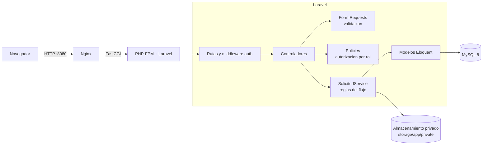
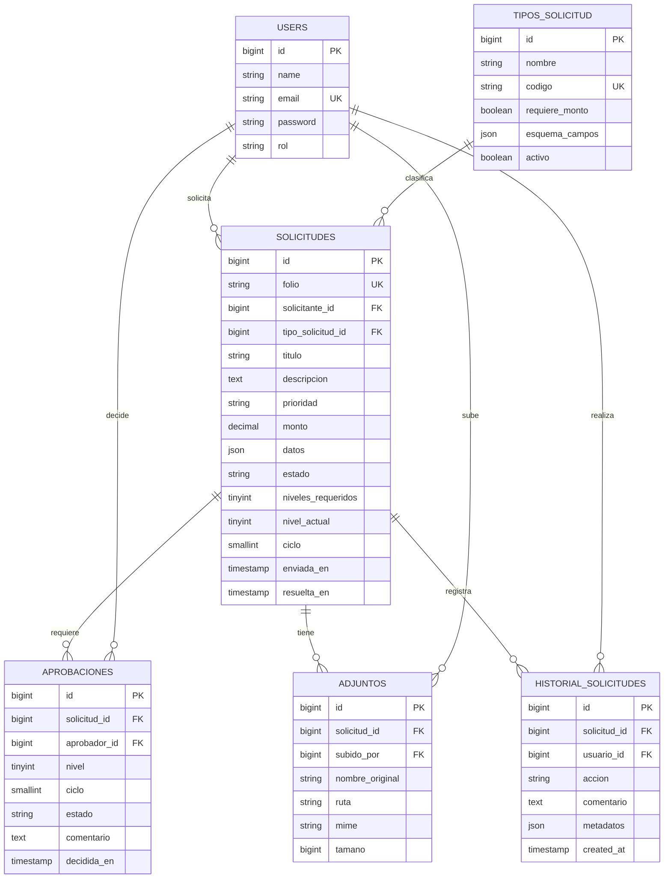
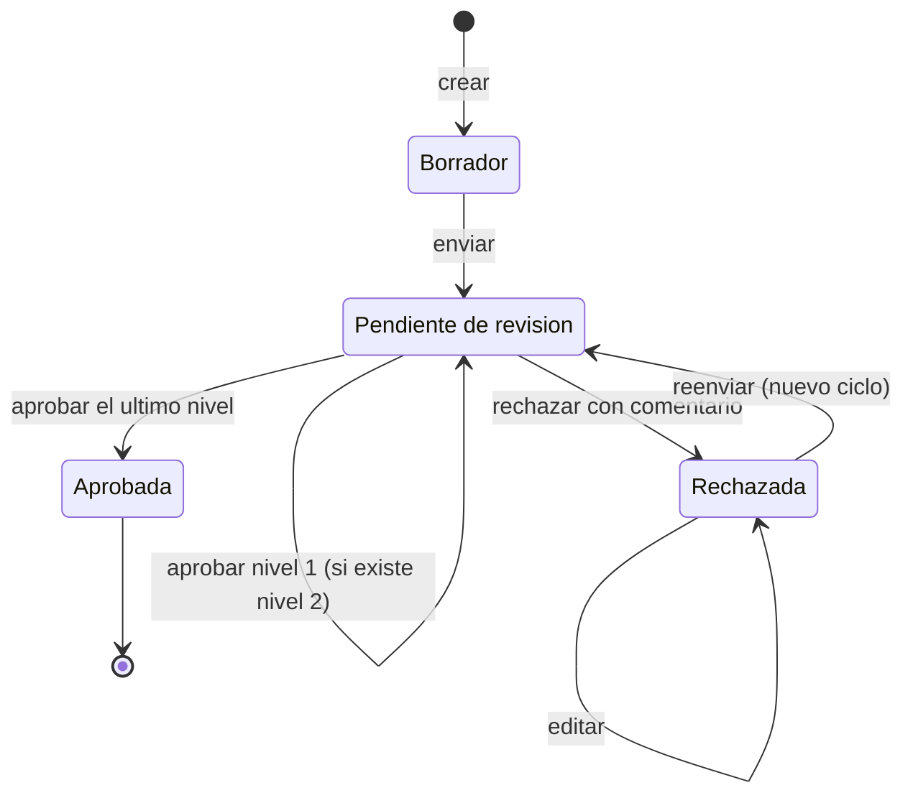
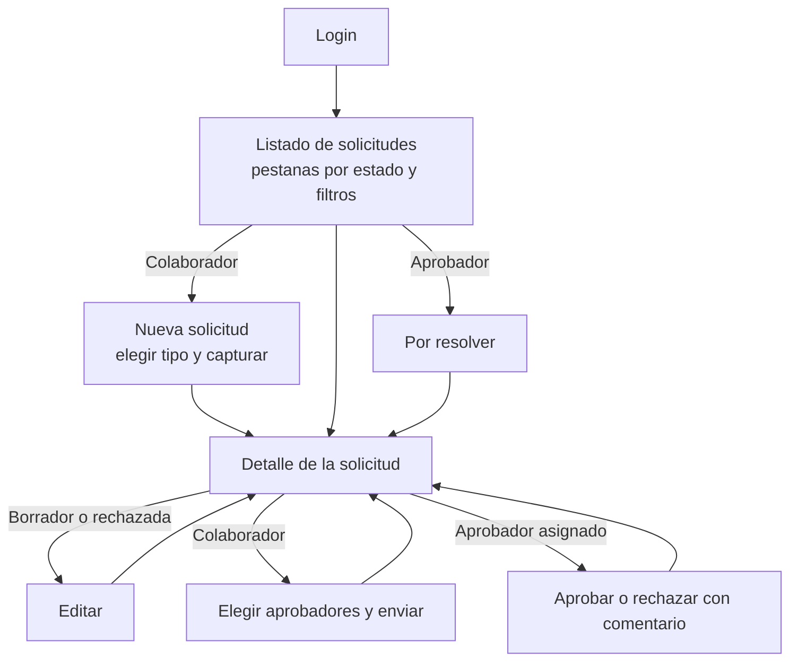
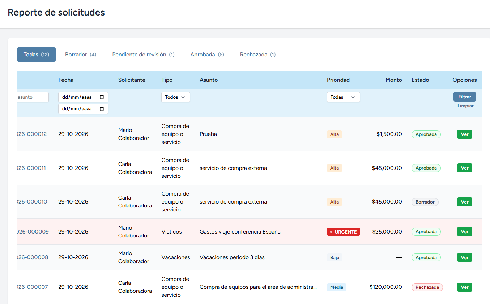
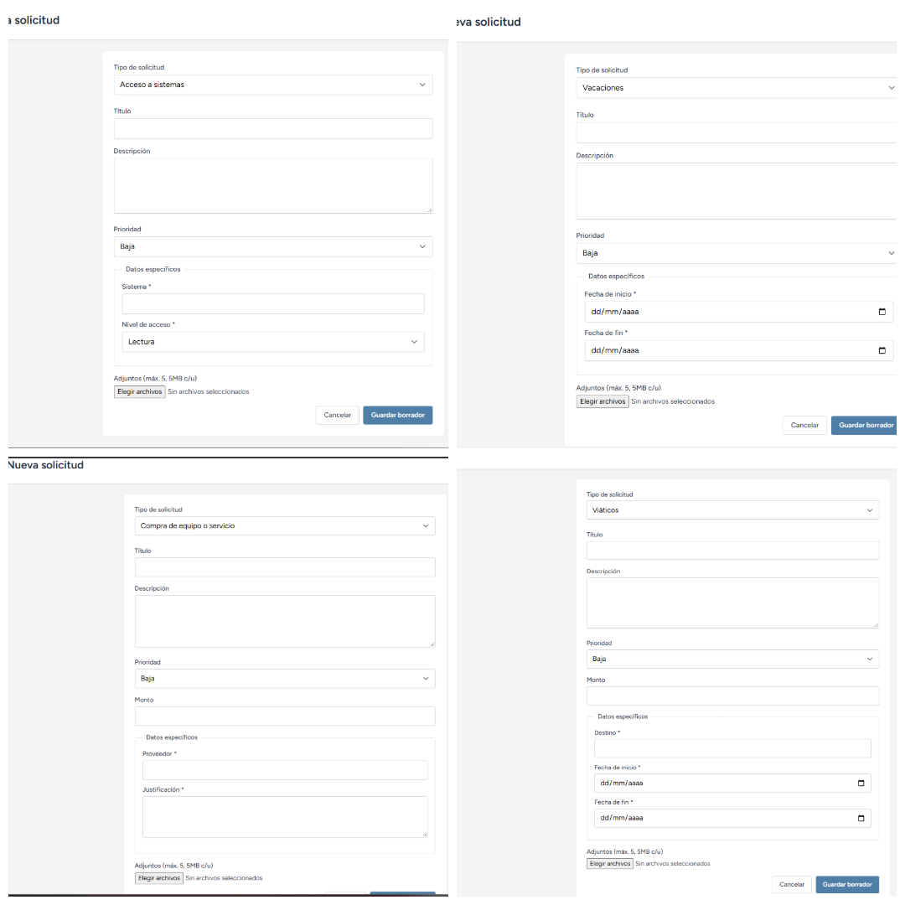
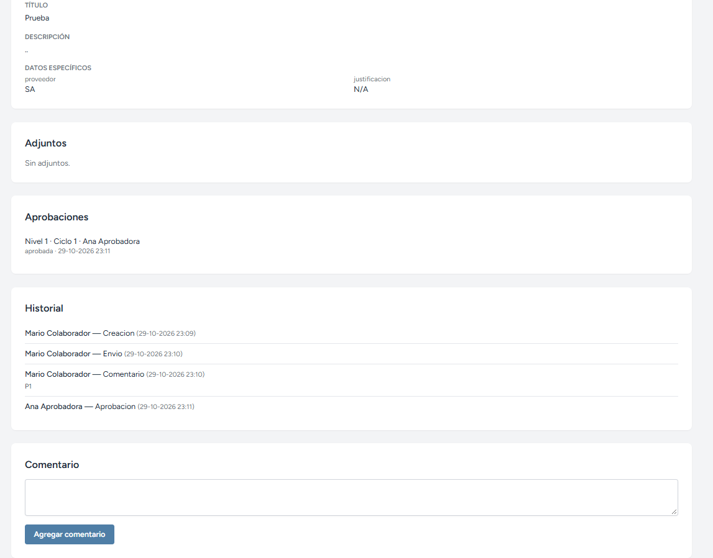
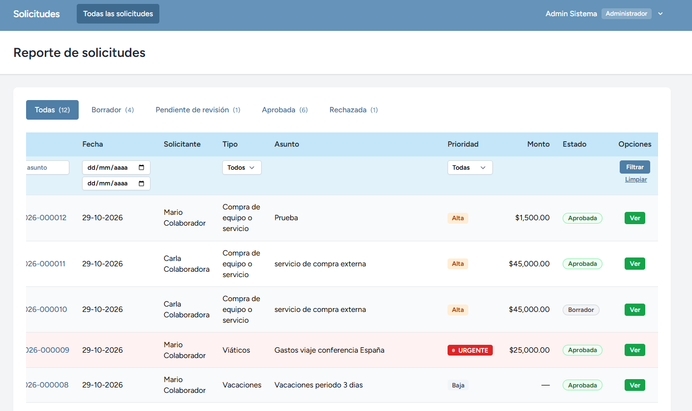
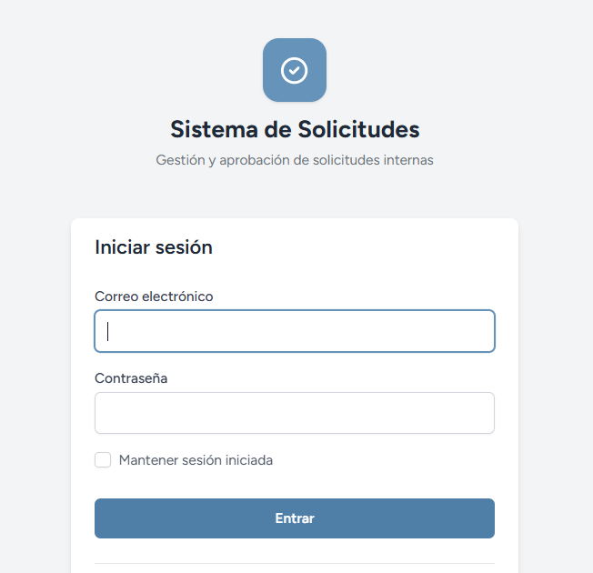

# Sistema Interno de Solicitudes y Aprobaciones

Prototipo funcional de una plataforma centralizada para **crear, dar seguimiento y aprobar solicitudes internas**, con trazabilidad completa de cada acción. Desarrollado como prueba técnica para Full Stack Developer (área de Inteligencia de Datos Auditoría).

**Stack:** Laravel 13 · PHP 8.3 · MySQL 8 · Blade + Alpine.js + Tailwind CSS (Laravel Breeze) · Vite · Docker (Nginx + PHP-FPM)

---

## 1. Inicio rápido

Requisitos: Docker Desktop (o Docker Engine con Compose v2).

```bash
git clone <repositorio> && cd <carpeta>
docker compose up --build
```

Abrir <http://localhost:8080>. La primera vez tarda unos minutos: el contenedor instala las dependencias de Composer, ejecuta las migraciones y carga los datos de demostración (todo automático).

Notas:

- En Linux con un UID distinto de 1000: `HOST_UID=$(id -u) HOST_GID=$(id -g) docker compose up --build`.
- En distribuciones con SELinux (Fedora, RHEL) los volúmenes llevan la etiqueta `:z`; en Windows/macOS se ignora sin problema.
- Base de datos expuesta en `localhost:3307` (usuario `app`, contraseña `secret`, base `solicitudes`) solo para desarrollo.
- Opcional: administrador web de la base de datos con `docker compose --profile tools up -d adminer` y abrir <http://localhost:8081> (sistema MySQL, servidor `db`).
- Pruebas automatizadas: `docker compose exec app php artisan test`.
- Reiniciar los datos de demostración: `docker compose exec app php artisan migrate:fresh --seed` y después `docker compose exec app php artisan db:seed --class=DemoSeeder`.

## 2. Usuarios de demostración

Contraseña de todos: `password` (solo para entorno de desarrollo). En entorno `local`, la pantalla de login muestra accesos rápidos a cada usuario.

| Correo | Usuario | Rol |
|---|---|---|
| `colaborador1@example.com` | Carla Colaboradora | Colaborador |
| `colaborador2@example.com` | Mario Colaborador | Colaborador |
| `aprobador1@example.com` | Ana Aprobadora | Aprobador |
| `aprobador2@example.com` | Luis Aprobador | Aprobador |
| `admin@example.com` | Admin Sistema | Administrador |

Los datos de demostración incluyen solicitudes en todos los estados: borrador, pendiente en nivel 1, pendiente en nivel 2 (urgente), aprobadas con uno y dos niveles, rechazada, y una rechazada que fue corregida y reenviada (ciclo 2).

## 3. Funcionalidad

### Por rol

| Rol | Puede hacer |
|---|---|
| **Colaborador** | Crear solicitudes; elegir tipo y capturar los campos que ese tipo exige; adjuntar documentos; editar mientras esté en borrador o rechazada; enviar y reenviar eligiendo a sus aprobadores; consultar **solo sus propias** solicitudes con estado, historial, comentarios y responsables. |
| **Aprobador** | Ver las solicitudes **asignadas a él**; filtrar por estado, tipo, prioridad y fecha; pestaña "Por resolver" con las que esperan su decisión; revisar el detalle completo; aprobar o rechazar con comentario; comentar; consultar el historial. |
| **Administrador** | Visualizar **todas** las solicitudes y su historial completo (solo lectura). |

### Reglas de negocio implementadas

- **Flujo:** `Borrador → Pendiente de revisión → Aprobada | Rechazada`. Las aprobadas concluyen el proceso; las rechazadas pueden **editarse y reenviarse** (nuevo ciclo de revisión).
- **Segunda aprobación:** si el monto es **mayor a $50,000 MXN** se requieren dos niveles, en orden. El umbral vive en `config/solicitudes.php` (variable `SOLICITUDES_UMBRAL_SEGUNDA_APROBACION`).
- **Prioridad:** Baja, Media, Alta y Urgente. Las **urgentes** se destacan en los listados (fila resaltada, borde y etiqueta animada).
- **Historial:** toda acción relevante queda registrada con fecha, usuario y acción: creación, edición, envío, reenvío, aprobación, rechazo y comentario. El historial es de solo inserción.
- **Folio único** autogenerado (`SOL-AAAA-000001`).
- **Filtros del listado:** pestañas por estado (con conteo), tipo, prioridad, rango de fechas y búsqueda por folio o asunto.

### Rutas principales

| Método | Ruta | Descripción |
|---|---|---|
| GET | `/solicitudes` | Listado con filtros, pestañas y paginación |
| GET/POST | `/solicitudes/create`, `/solicitudes` | Formulario dinámico por tipo y creación |
| GET | `/solicitudes/{solicitud}` | Detalle: datos, adjuntos, aprobadores e historial |
| GET/PUT | `/solicitudes/{solicitud}/edit`, `/solicitudes/{solicitud}` | Edición (borrador o rechazada) |
| POST | `/solicitudes/{solicitud}/enviar` | Enviar o reenviar a revisión eligiendo aprobadores |
| POST | `/solicitudes/{solicitud}/aprobar` · `/rechazar` | Decisión del aprobador (el rechazo exige comentario) |
| POST | `/solicitudes/{solicitud}/comentarios` | Agregar comentario |
| GET | `/adjuntos/{adjunto}` | Descarga autorizada de un adjunto |

## 4. Arquitectura

Monolito Laravel en capas, con la **lógica del flujo concentrada en un único servicio**. Los controladores solo validan, autorizan y delegan.



| Capa | Responsabilidad | Ubicación |
|---|---|---|
| Rutas y middleware | Autenticación obligatoria, enrutamiento | `routes/web.php` |
| Controladores | Orquestar la petición; sin reglas de negocio | `app/Http/Controllers` |
| Form Requests | Validación de entrada (incluye campos dinámicos por tipo) | `app/Http/Requests` |
| Policies | Quién puede ver, editar, enviar, resolver y comentar | `app/Policies/SolicitudPolicy.php` |
| Servicio | Máquina de estados, niveles de aprobación, historial, transacciones | `app/Services/SolicitudService.php` |
| Modelos y enums | Entidades, relaciones, casts y alcances (`visiblesPara`, `filtrar`) | `app/Models`, `app/Enums` |
| Vistas | Blade + componentes (insignias de estado y prioridad) | `resources/views` |

Estructura del repositorio:

```
.
├── docker/
│   ├── php/            Dockerfile y entrypoint (instala, migra, siembra)
│   └── nginx/          Configuración del servidor web
├── docker-compose.yml
└── src/                Aplicación Laravel
```

## 5. Modelo de datos



Puntos clave del modelo:

- **`niveles_requeridos` y `nivel_actual`** modelan la segunda aprobación sin inventar estados nuevos: agregar un tercer nivel no cambia el esquema.
- **`ciclo`** se incrementa cada vez que una solicitud rechazada se reenvía. Las aprobaciones de ciclos anteriores se conservan, y la restricción única `(solicitud_id, ciclo, nivel)` impide duplicados.
- **`esquema_campos` / `datos`:** cada tipo de solicitud define en JSON qué campos extra se capturan y de qué tipo (texto, número, fecha, lista). Los valores se guardan en `datos`.
- **`historial_solicitudes`** no tiene `updated_at` ni se borra en cascada: es una bitácora de auditoría.
- **Índices:** `(estado, prioridad)` y `created_at` en solicitudes para los filtros del listado; `(aprobador_id, estado)` en aprobaciones para la bandeja "Por resolver".

## 6. Flujo de la solicitud



Ejemplo con monto de $60,000: Carla crea y envía eligiendo a Ana (nivel 1) y Luis (nivel 2) → Ana aprueba y la solicitud sigue pendiente → Luis aprueba y queda **Aprobada**. Si Ana rechaza, el flujo termina ahí, Carla corrige y reenvía, y comienza el ciclo 2.

## 7. Flujo de navegación



## 8. Decisiones de diseño

| Decisión | Justificación | Compromiso / alternativa |
|---|---|---|
| **Monolito en capas** (controlador → servicio → modelos) | Prototipo mantenible y fácil de razonar; la lógica del flujo está en un solo lugar y se reutiliza desde web, pruebas o una futura API. | Un microservicio de flujos solo se justifica si varios sistemas lo consumen. |
| **`SolicitudService` con transacciones y bloqueo de fila** (`lockForUpdate`) | Dos decisiones simultáneas sobre la misma solicitud no pueden corromper el estado. | Más código que actualizar el modelo directo, pero las reglas no se duplican. |
| **Estado `Borrador` previo a `Pendiente de revisión`** | El requerimiento pide registrar "Creación" y "Envío" como acciones distintas, y permite editar antes de enviar. Se interpreta que la solicitud entra al flujo de revisión al enviarse. | Si se prefiere que nazca pendiente, basta fusionar creación y envío. |
| **Niveles de aprobación como datos** (`niveles_requeridos`, `nivel_actual`) | Extensible: un tercer nivel no requiere migración ni estados nuevos. | La regla de niveles está hoy en código y config; podría pasar a una tabla de reglas. |
| **`ciclo` para reenvíos** | Conserva la trazabilidad de cada revisión tras un rechazo. | Una fila más por nivel y ciclo. |
| **Historial de solo inserción** | Naturaleza de auditoría: lo ocurrido no se modifica ni se borra (el modelo bloquea `update` y `delete`). | Para auditoría estricta se podría encadenar hashes. |
| **Campos por tipo en JSON** | Nuevos tipos sin tocar código ni esquema; validación generada desde el esquema. | No se filtra eficientemente por esos campos; por eso los filtros solicitados están en columnas normales. |
| **Rol como columna con enum** | Tres roles fijos: suficiente y simple. | Si crecen los permisos, migrar a `spatie/laravel-permission`. |
| **El solicitante elige a sus aprobadores** | Cumple "identificar a los responsables" con poco costo. | Evolución: asignación automática por reglas (tipo, área, jerarquía). |
| **Filtros y paginación en el servidor** | Escala con miles de solicitudes: solo viaja la página solicitada. | Las tablas con filtrado en cliente (DataTables clásico) cargan todo en el navegador. |
| **Adjuntos en disco privado con descarga autorizada** | Nadie accede a un documento por URL directa; se valida la Policy en cada descarga. | Para producción: almacenamiento compatible con S3. |
| **Blade + Alpine + Tailwind** en lugar de SPA | Menos piezas, una sola aplicación, buena experiencia de usuario con poco JavaScript. | Si se necesitaran vistas muy interactivas, se puede añadir Livewire o una SPA sobre las mismas rutas. |
| **Docker con entrypoint automático** | Quien evalúa levanta todo con un comando. | Para producción, imagen con el código incluido y construcción de assets en etapa separada. |
| **Nombres de dominio en español**; `users` conserva la convención de Laravel | Claridad para el equipo de negocio; el framework (sesiones, restablecimiento de contraseña) asume `users`. | Se documenta la excepción. |

## 9. Seguridad

- **Autenticación** con Laravel Breeze (sesiones, protección CSRF, límite de intentos de acceso). Sin registro público: las cuentas las provisiona el sistema.
- **Autorización por Policies** aplicada en cada ruta y también reflejada en la interfaz; además, el servicio valida las reglas del flujo (quién puede decidir y en qué momento), por lo que no se depende de ocultar botones.
- **El rol no es asignable** desde ningún formulario; los controladores usan solo datos validados (nunca `request()->all()`).
- **Validación de entrada** con Form Requests: el monto está prohibido en tipos que no lo usan (no se puede forzar la segunda aprobación), el tipo no cambia tras crearse y los aprobadores deben tener rol Aprobador, ser distintos entre sí y no ser el solicitante.
- **Adjuntos:** tipos permitidos (PDF, PNG, JPG, DOCX, XLSX), máximo 5 archivos de 5 MB por envío, almacenamiento privado y descarga autorizada.
- **Doble envío:** los formularios deshabilitan el botón al enviar y la base de datos impide duplicados en aprobaciones.
- **Mejoras para producción:** SSO corporativo con MFA, antivirus para adjuntos, cifrado en reposo, registro de IP y agente de usuario en el historial, y gestión de secretos fuera del repositorio.

## 10. Escalabilidad y rendimiento

Hoy: índices alineados con los filtros, paginación y filtros en el servidor, carga anticipada de relaciones (sin N+1 en el listado), exportación en flujo continuo (`lazyById`) y bloqueos a nivel de fila.

Para 5,000+ colaboradores y crecimiento:

1. Aplicación sin estado → varias instancias detrás de un balanceador.
2. Sesiones y caché en Redis; cola de trabajos para notificaciones y exportaciones grandes.
3. Adjuntos en almacenamiento de objetos (compatible con S3) con URLs firmadas.
4. Réplica de lectura para reportes; particionado o archivado de historial muy antiguo.
5. Observabilidad: logs centralizados, métricas y alertas.

## 11. Pruebas

```bash
docker compose exec app php artisan test
```

Pruebas automatizadas de feature sobre el flujo de aprobación y sus reglas:

<!-- Ajusta esta lista a las pruebas que realmente existen en tu proyecto -->
- Aprobación con un nivel y con dos niveles (monto mayor a $50,000).
- Rechazo con comentario, edición y reenvío con nuevo ciclo.
- Permisos por rol: el colaborador solo ve lo suyo, el aprobador solo lo asignado, el administrador es de solo lectura.
- Reglas de validación y protección contra doble envío.

## 12. Plan de migración y estrategia

Situación actual: solicitudes por correo, mensajería y archivos compartidos, sin trazabilidad. El objetivo es adoptar la plataforma **sin interrumpir la operación** y con evidencia de valor desde el principio.

### Principios

1. **Valor temprano, riesgo acotado:** empezar con pocos tipos de solicitud y un área piloto.
2. **Un solo canal oficial por solicitud:** durante la transición no conviven dos fuentes de verdad para el mismo trámite.
3. **Medir antes de ampliar:** cada fase tiene criterios de salida claros.

### Fases

| Fase | Alcance | Duración orientativa | Criterio de salida |
|---|---|---|---|
| **0. Descubrimiento** | Inventario de tipos de solicitud, flujos reales, volúmenes, responsables y umbrales por área. | 2 semanas | Catálogo priorizado (impacto frente a complejidad) y dueños de proceso definidos. |
| **1. Piloto** | 1–2 áreas (50–100 usuarios) y los 2–3 tipos de solicitud más frecuentes. Las solicitudes nuevas de esos tipos se registran solo en la plataforma. | 4–6 semanas | Más del 80 % de las solicitudes piloto en la plataforma; ajustes de usabilidad cerrados. |
| **2. Integración** | SSO con el directorio corporativo, notificaciones por correo, asignación automática de aprobadores según jerarquía. | 4 semanas | Sin altas manuales de usuarios; aprobadores notificados. |
| **3. Despliegue por olas** | Resto de áreas en olas de 500–1,000 usuarios, con capacitación y "campeones" por área. | 8–12 semanas | Adopción por ola mayor al 80 % y tiempos de ciclo medidos. |
| **4. Cierre del canal anterior** | Se deja de aceptar solicitudes por correo y archivos compartidos; el correo responde con redirección a la plataforma. | 2 semanas | Canal anterior sin tráfico nuevo. |

### Datos históricos

- Migrar **solo las solicitudes abiertas** al modelo nuevo (script de importación desde hoja de cálculo, con vista previa y validación) y marcarlas como "migradas".
- Las cerradas se archivan en un repositorio de consulta; se importan después solo si el negocio lo requiere (auditoría).
- Validar con muestras y conciliar totales por área antes de cada corte.

### Riesgos y mitigaciones

| Riesgo | Probabilidad / impacto | Mitigación |
|---|---|---|
| **Baja adopción** (se sigue usando el correo) | Alta / Alto | Patrocinio directivo, canal único por tipo en el piloto, "campeones" por área, indicadores visibles de ahorro de tiempo. |
| **Aprobadores como cuello de botella** | Media / Alto | Recordatorios, escalamiento por antigüedad, delegación por ausencia (pendiente en el alcance actual). |
| **Procesos distintos entre áreas** | Alta / Medio | Tipos de solicitud configurables mediante esquema, sin cambios de código; flujos por área en iteraciones. |
| **Calidad de los datos migrados** | Media / Medio | Migrar solo lo abierto, validaciones de importación, conciliación por muestras. |
| **Seguridad y confidencialidad de documentos** | Media / Alto | Roles mínimos, adjuntos privados, historial inmutable, SSO con MFA, revisión de accesos periódica. |
| **Rendimiento al escalar** | Baja / Alto | Plan de escalamiento (sección 10), pruebas de carga antes de las olas grandes. |
| **Dependencia de pocas personas** | Media / Medio | Documentación, entorno reproducible con Docker, pruebas automatizadas, revisión de código. |

### Indicadores de éxito

Tiempo promedio de ciclo (creación a resolución), porcentaje de solicitudes gestionadas en la plataforma, porcentaje con trazabilidad completa, solicitudes vencidas sin respuesta y satisfacción de solicitantes y aprobadores.

## 13. Alcance, supuestos y mejoras futuras

**Supuestos:** una solicitud entra al flujo de revisión al enviarse (existe `Borrador` previo); los aprobadores los elige el solicitante; las cuentas las gestiona el sistema; los montos se manejan en MXN.

**Fuera del alcance de este prototipo (priorizadas):**

1. Notificaciones por correo y dentro de la aplicación (eventos del servicio + cola).
2. SSO corporativo (OIDC/SAML) con mapeo de grupos a roles.
3. Delegación por ausencia y reasignación de aprobadores por el administrador (con registro en el historial).
4. API REST para integraciones, reutilizando servicio y Policies.
5. Reglas de aprobación configurables (por tipo, monto, área) y escalamiento por tiempo.
6. Reportes avanzados y tableros; auditoría exportable.
7. Traducción completa de mensajes de validación y paginación.

**Cómo extender:**

- *Un tercer nivel de aprobación:* ajustar `SolicitudService::nivelesRequeridos()` (por ejemplo, otro umbral en `config/solicitudes.php`) y mostrar un selector adicional de aprobador; no requiere migración.
- *Un nuevo tipo de solicitud:* agregar un registro en `tipos_solicitud` con su `esquema_campos`; el formulario y la validación se generan solos.
- *Notificaciones:* emitir eventos desde el servicio (`SolicitudEnviada`, `SolicitudAprobada`, `SolicitudRechazada`) y atenderlos con listeners en cola.

## 14. Actividades realizadas

<!-- Ajusta los días y el detalle a tu cronograma real -->

| Día | Actividades |
|---|---|
| 1 | Análisis del caso y de las reglas de negocio; entorno Docker (Nginx, PHP-FPM, MySQL); proyecto Laravel base; diseño del modelo de datos. |
| 2 | Migraciones, modelos, enums y seeders; `SolicitudService` con la máquina de estados, segunda aprobación e historial; autenticación, Policies y Form Requests. |
| 3 | Controladores y rutas; vistas (listado con filtros y pestañas, formulario dinámico por tipo, detalle con historial, bandeja del aprobador, login). |
| 4 | Pruebas automatizadas y corrección de errores (incluida la protección contra doble envío); verificación de entrega desde un clon limpio en otro equipo; datos de demostración. |
| 5 | Documentación (arquitectura, diagramas, decisiones, plan de migración) y preparación de la presentación. |

## 15. Capturas de pantalla


1. Listado con pestañas, filtros y solicitudes urgentes resaltadas.



2. Formulario de nueva solicitud (campos dinámicos según el tipo).



3. Detalle con aprobadores, adjuntos e historial.



4. Vista del administrador (solo lectura).



5. Login de inicio de sesión.


